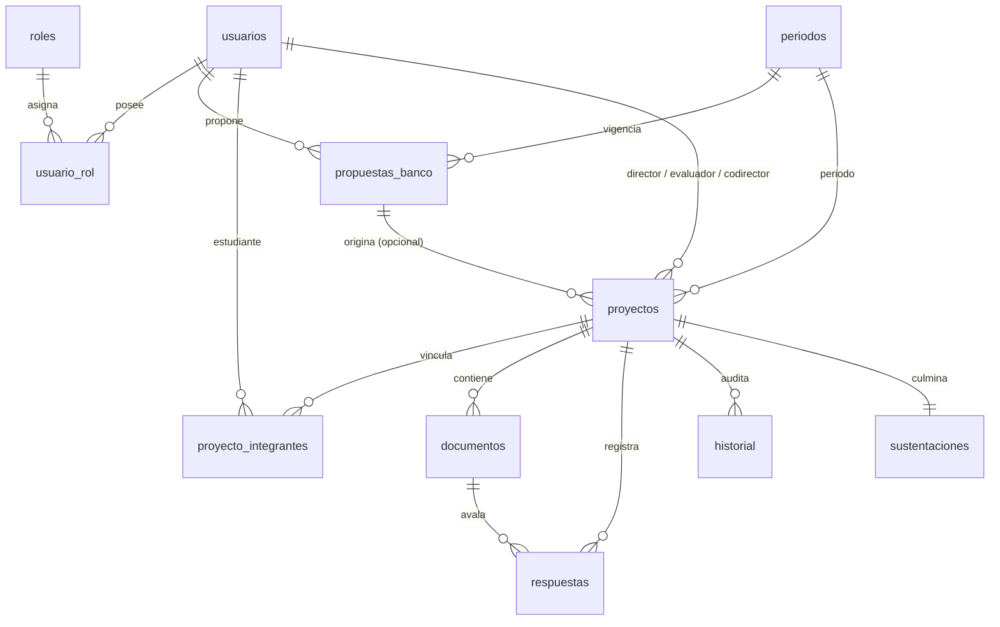

# SISTEMA DE GESTIÓN DE TRABAJOS DE GRADO (SIGRADO - UTS)
## INGENIERÍA DE SISTEMAS · UNIDADES TECNOLÓGICAS DE SANTANDER
### Requisitos Funcionales y No Funcionales · Guion de Funcionamiento · Modelo de Base de Datos y Arquitectura
**Versión Organizada · Octubre de 2026**

---

## 1. INTRODUCCIÓN Y ALCANCE

### 1.1 Objetivo
El sistema gestiona el ciclo de vida completo del trabajo de grado en el programa de Ingeniería de Sistemas:
1. Banco de ideas de grado (propuestas por docentes o estudiantes).
2. Inscripción formal del proyecto con verificación del comprobante de pago de derechos pecuniarios (modalidad individual o en pareja de máximo 2 estudiantes).
3. Seguimiento y trazabilidad continua en **6 fases académicas**.
4. Entrega de documentos y productos mediante enlaces válidos (URL HTTPS), con control e historial estricto de versiones.
5. Ciclos iterativos de revisión, emisión de conceptos y correcciones.
6. Cierre formal con registro de sustentación y generación de actas.

---

### 1.2 Roles del Sistema
El sistema cuenta con **cuatro (4) roles de cuenta exactos**, correspondientes al tipo enumerado de la tabla `roles`:

| Rol de Cuenta | Descripción y Alcance |
| :--- | :--- |
| **Administrador** | Gestiona usuarios y asignación de roles, calendario académico (periodos), catálogo de formatos institucionales de grado y copias de seguridad del sistema. Administra proyectos y aprueba/rechaza las ideas postuladas al banco. Asume integralmente las funciones de coordinación académica (no existe rol de coordinación ni de secretaría). Puede también dirigir proyectos si cuenta adicionalmente con el rol docente. |
| **Comité** | Órgano colegiado decisorio en las fases 1, 3, 5 y 6. En la aprobación de Fase 1 verifica el comprobante de pago, genera el código oficial de modalidad (`65-AAAA-XXX` para nivel Tecnológico o `125-AAAA-XXX` para Profesional) y asigna el Director, Evaluador y Codirector (opcional). |
| **Docente** | Postula ideas temáticas al banco de proyectos. Puede ser asignado a proyectos específicos en tres modalidades: Director, Evaluador o Codirector. |
| **Estudiante** | Consulta y postula ideas del banco (o formula una propia), registra el comprobante de pago de derechos, entrega enlaces de documentos por fase, atiende solicitudes de corrección y sustenta su proyecto de grado. |

> [!IMPORTANT]
> **Asignaciones por proyecto vs. Roles de cuenta**:
> - *Director*, *Evaluador* y *Codirector* **NO son roles de cuenta**: son asignaciones contractuales por proyecto (`director_id`, `evaluador_id`, `codirector_id` en la tabla `proyectos`).
> - Un usuario puede poseer múltiples roles simultáneos mediante la tabla asociativa `usuario_rol` (por ejemplo, un Administrador que además posee rol Docente para dirigir proyectos). El sistema provee cambio dinámico de perfil (`elegir_rol.jsp` y `cambiar_rol.jsp`) sin cerrar sesión.

---

### 1.3 Supuestos y Decisiones de Diseño
1. **Inexistencia de Rol Coordinador/Secretaría**: Todas las atribuciones administrativas y de coordinación son ejecutadas directamente por el Administrador.
2. **Incompatibilidad de Asignación Docente**: Un docente puede desempeñarse como Director en determinados proyectos y Evaluador en otros, pero **bajo ninguna circunstancia puede ser Director y Evaluador del mismo proyecto**.
3. **Punto de Asignación Docente**: El Comité asigna Director, Evaluador y Codirector en el formulario de aprobación de la Fase 1; dichas asignaciones entran en vigor operativo a partir de la Fase 2.
4. **Unificación de Estados de Observación**: *"Aplazado"*, *"No aprobado"* y *"Correcciones"* constituyen el mismo estado operativo. En base de datos se almacena canónicamente como `Correcciones`; la vista puede rotularlo contextualmente según el rol que dictamina.
5. **Cero Carga de Archivos Físicos**: La totalidad de entregables se gestionan exclusivamente mediante URLs seguras (HTTPS). No se almacena peso binario en el servidor web.
6. **Estructura del Código de Modalidad**:
   - Prefijo **`65`**: Nivel Tecnológico.
   - Prefijo **`125`**: Nivel Profesional.
   - Estructura: `[Prefijo]-[Año]-[Consecutivo]` (ejemplo: `65-2026-284`).

---

## 2. REQUISITOS DEL SISTEMA

### 2.1 Requisitos Funcionales Generales (Transversales)
* **RF-GEN-01**: Página de aterrizaje pública con descripción detallada del proceso, diagrama de las 6 fases, fechas del periodo académico vigente, formatos institucionales descargables y acceso al inicio de sesión.
* **RF-GEN-02**: Autenticación segura mediante correo institucional (@correo.uts.edu.co) y credenciales encriptadas.
* **RF-GEN-03**: Menú y permisos dinámicos según el rol activo. Soporte de cambio de perfil (`elegir_rol.jsp` / `cambiar_rol.jsp`) para usuarios con múltiples roles sin invalidar sesión.
* **RF-GEN-04**: Edición de perfil personal (teléfono y clave de acceso). Los campos de documento y correo institucional permanecen inmutables.
* **RF-GEN-05**: Validación obligatoria de enlaces HTTPS en cada entrega documental.
* **RF-GEN-06**: Historial de versiones incremental e inmutable: cada nueva entrega o corrección genera una versión secuencial superior conservando íntegro el histórico anterior.
* **RF-GEN-07**: Registro exhaustivo de decisiones (Aprobado, Correcciones, Rechazado) con responsable, fase, ronda de evaluación, fecha/hora, número de acta y comentarios.
* **RF-GEN-08**: Tablas y listados con filtros por estado y fase, ordenamiento dinámico y paginación en servidor.
* **RF-GEN-09**: Mensaje de confirmación estándar (*"Respuesta enviada correctamente"*) y alternancia automática del turno hacia el siguiente actor.
* **RF-GEN-10**: Mapa visual interactivo de las 6 fases con resaltado en verde de la fase alcanzada, botón de inspección (icono ojo) y botón de emisión de concepto para el actor en turno.
* **RF-GEN-11**: Restricción de operaciones en función del calendario del periodo académico activo.
* **RF-GEN-12**: Detalle integral del proyecto con ficha técnica, modalidad, nivel, integrantes y docentes asignados.

---

### 2.2 Requisitos del Administrador
* **RF-ADM-01**: CRUD integral de usuarios, asignación de los 4 roles permitidos y baja lógica.
* **RF-ADM-02**: Filtro y búsqueda ágil de usuarios por documento, nombre, correo o rol.
* **RF-ADM-03**: Configuración de periodos académicos (único periodo activo a la vez) con ventanas de fechas para banco de ideas, radicación y aprobación de propuestas.
* **RF-ADM-04**: Gestión del catálogo de formatos oficiales (F-DC-124, F-DC-125, F-DC-129, etc.).
* **RF-ADM-05**: Generación y descarga de copias de seguridad de la base de datos.
* **RF-ADM-06**: Supervisión global de proyectos, filtros avanzados y cancelación justificada.
* **RF-ADM-07**: Evaluación de ideas del banco: aprobación directa, solicitud de correcciones o rechazo.
* **RF-ADM-08**: Aprobación de ideas propuestas por docentes sin exigencia de comprobante de pago.
* **RF-ADM-09**: Aprobación de ideas propuestas por estudiantes condicionada a la existencia y validez del comprobante de pago.
* **RF-ADM-10**: Monitoreo de disponibilidad del banco de ideas.
* **RF-ADM-11**: Reasignación de Director, Evaluador o Codirector con trazabilidad en bitácora.
* **RF-ADM-12**: Consulta centralizada de formatos y calendario académico.

---

### 2.3 Requisitos del Comité
* **RF-COM-01**: Fase 1: Inspección de propuesta y URL de comprobante de pago; emisión de concepto (Aprobado, Correcciones, Rechazado) con número y fecha de acta.
* **RF-COM-02**: En caso de Aprobado en Fase 1: visualización del código de modalidad generado (65 o 125) y asignación obligatoria de Director y Evaluador (Codirector opcional).
* **RF-COM-03**: En caso de Correcciones o Rechazado en Fase 1: formulario simplificado con número de acta, fecha y observaciones.
* **RF-COM-04**: Fase 3: Evaluación final de propuesta tras el concepto del Evaluador; aprobación para avance a Fase 4 o devolución a Fase 2.
* **RF-COM-05**: Fase 5: Evaluación de informe final con F-DC-125 y F-DC-129 avalados por Evaluador; decisión de aprobación para avance a Fase 6 o aplazamiento a Fase 4.
* **RF-COM-06**: Fase 6: Verificación de lista de chequeo documental, sustentación final y cierre definitivo del proyecto en estado `Finalizado`.
* **RF-COM-07**: Auditoría de usuarios, banco de ideas, propuestas y proyectos con sus respectivas versiones.
* **RF-COM-08**: Consulta del calendario académico vigente.

---

### 2.4 Requisitos del Docente
* **RF-DOC-01**: Formulación de ideas al banco (título, modalidad, objetivo, línea, nivel y periodo) y seguimiento de estado.
* **RF-DOC-02**: Consulta de retroalimentaciones del Administrador sobre sus ideas formuladas.
* **RF-DOC-03**: Acceso segmentado a sus proyectos mediante paneles diferenciados: *"Docente Director"* y *"Docente Evaluador"*.

---

### 2.5 Requisitos del Director (Asignación por Proyecto)
* **RF-DIR-01**: Visualización de sus proyectos dirigidos con mapa interactivo de fases.
* **RF-DIR-02**: Fase 2: Evaluación de anteproyecto con URL obligatoria de reporte Turnitin y dictamen (Aprobado, Correcciones o No aprobado).
* **RF-DIR-03**: Transición automática a Fase 3 (turno del Evaluador) ante concepto Aprobado en Fase 2.
* **RF-DIR-04**: Fase 4: Revisión del informe de avance presentado por el estudiante y emisión de aval hacia Fase 5.
* **RF-DIR-05**: Participación en la programación y acompañamiento de la sustentación (Fase 6).

---

### 2.6 Requisitos del Evaluador (Asignación por Proyecto)
* **RF-EVA-01**: Visualización de proyectos asignados para evaluación y descarga de antecedentes documentales.
* **RF-EVA-02**: Fase 3: Evaluación de la propuesta y Turnitin; registro de URL de la propuesta firmada (F-DC-124) y observaciones. Al aprobar, traslada turno al Comité.
* **RF-EVA-03**: Fase 5: Calificación de informe final con entrega de URL del informe firmado (F-DC-125), URL de rejilla evaluativa firmada (F-DC-129), acta y comentarios.
* **RF-EVA-04**: Participación en el jurado de sustentación (Fase 6).

---

### 2.7 Requisitos del Estudiante
* **RF-EST-01**: Exploración del catálogo de ideas aprobadas y disponibles para selección directa.
* **RF-EST-02**: Postulación de idea propia si no opta por el banco institucional.
* **RF-EST-03**: Registro del proyecto en modalidad individual o con un compañero de fórmula (el segundo integrante debe estar previamente registrado y libre de proyectos activos).
* **RF-EST-04**: Registro de la URL del comprobante de pago de derechos de grado.
* **RF-EST-05**: Consulta en tiempo real del mapa de fases, responsable en turno y estado general.
* **RF-EST-06**: Fase 2: Entrega de la URL del anteproyecto al Director.
* **RF-EST-07**: Fase 4: Entrega de la URL del informe de desarrollo al Director.
* **RF-EST-08**: Consulta detallada de observaciones de evaluación y radicación de nuevas versiones en rondas de corrección.
* **RF-EST-09 (RNF-04)**: Visualización exclusiva de Director y Codirector, **restringiendo por completo la visibilidad de la identidad del Evaluador docente**.
* **RF-EST-10**: Consulta cronológica del historial de versiones y respuestas.

---

## 3. REQUISITOS NO FUNCIONALES (RNF)

| ID | Categoría | Especificación |
| :--- | :--- | :--- |
| **RNF-01** | Plataforma Web | Accesible universalmente mediante navegadores estándar modernos sin requerir complementos de escritorio. |
| **RNF-02** | Control de Acceso | Aislamiento estricto de vistas mediante `guard` por rol en `WEB-INF/jspf/`. |
| **RNF-03** | Usabilidad y Diseño | Interfaz corporativa moderna estilo SaaS, con iconografía SVG limpia, chips visuales de fase/turno y mensajes de alerta no intrusivos. |
| **RNF-04** | Privacidad del Evaluador | Anonimato garantizado del Evaluador ante los estudiantes vinculados al proyecto. |
| **RNF-05** | Trazabilidad Total | Bitácora inmutable de versiones de entregables y actas de evaluación por ronda. |
| **RNF-06** | Integridad Documental | Gestión exclusiva de documentos mediante enlaces HTTPS validados. |
| **RNF-07** | Control Temporal | Habilitación de acciones condicionada a las ventanas de fechas del periodo académico activo. |
| **RNF-08** | Seguridad y Respaldo | Contraseñas protegidas mediante algoritmos de hash y módulo de copia de seguridad para el Administrador. |

---

## 4. GUION DE FUNCIONAMIENTO Y FLUJO DE FASES

### 4.1 Reglas del Ciclo de Vida
* Cada proyecto se caracteriza por una **Fase (1 a 6)** y un **Responsable en Turno** (`comite`, `estudiante`, `director`, `evaluador`). Se representa en listados con doble chip informativo (ejemplo: `Fase 2 · Director`).
* El ciclo de vida (`estado`) de la tabla `proyectos` se limita estrictamente a:
  * `En curso` (en trámite en cualquiera de las fases 1 a 6)
  * `Rechazado` (proyecto cancelado por decisión académica)
  * `Cancelado` (anulado por el Administrador con causal motivada)
  * `Finalizado` (sustentado exitosamente y cerrado en Fase 6)
* Las decisiones evaluativas posibles en cada ronda son: `Aprobado`, `Correcciones` y `Rechazado`.
* Todo dictamen de `Correcciones` devuelve el proyecto a turno del estudiante para la radicación de una versión superior (incrementando `version` en `documentos` y `ronda` en `respuestas`).

---

### 4.2 Matriz de las 6 Fases Académicas

| Fase | Entregable | Actor que Evalúa | Transición si Aprueba | Transición si hay Correcciones |
| :---: | :--- | :--- | :--- | :--- |
| **1. Idea y Pago** | Estudiante: Selección/registro de idea y URL del comprobante de pago. | **Comité** | Pasa a **Fase 2**; genera código de modalidad y asigna Director, Evaluador y Codirector. | Retorna a `Fase 1 · Estudiante` para subsanar pago o propuesta. |
| **2. Propuesta I** | Estudiante: URL del anteproyecto. | **Director** | Director adjunta URL Turnitin; al aprobar pasa a **Fase 3 · Evaluador**. | Retorna a `Fase 2 · Estudiante`. |
| **3. Propuesta II** | Director traslada a Evaluador y Comité. | **Evaluador** y luego **Comité** | Evaluador adjunta F-DC-124 firmado. Comité avala y avanza a **Fase 4 · Estudiante**. | Retorna a `Fase 2 · Estudiante` para corrección de anteproyecto. |
| **4. Informe I** | Estudiante: URL de informe de avance. | **Director** | Director avala y avanza a **Fase 5 · Evaluador**. | Retorna a `Fase 4 · Estudiante`. |
| **5. Informe II** | Director traslada a Evaluador y Comité. | **Evaluador** y luego **Comité** | Evaluador adjunta F-DC-125 y F-DC-129 firmados. Comité avala y pasa a **Fase 6 · Comité**. | Retorna a `Fase 4 · Estudiante` (Aplazado). |
| **6. Cierre y Sustentación** | Programación de sustentación y verificación documental final. | **Comité** | Se registra sustentación (`sustentaciones`), se cierra el proyecto en estado **Finalizado**. | Comité solicita anexos o ajustes pendientes. |

---

### 4.3 Tabla de Transiciones de Turno

```
[F1 · Comité]     ──(Aprobado)──> [F2 · Estudiante] (Con Director y Evaluador asignados)
[F2 · Estudiante] ──(Entrega)───> [F2 · Director]
[F2 · Director]   ──(Aprobado)──> [F3 · Evaluador]
[F3 · Evaluador]  ──(Aprobado)──> [F3 · Comité]
[F3 · Comité]     ──(Aprobado)──> [F4 · Estudiante]
[F4 · Estudiante] ──(Entrega)───> [F4 · Director]
[F4 · Director]   ──(Aprobado)──> [F5 · Evaluador]
[F5 · Evaluador]  ──(Aprobado)──> [F5 · Comité]
[F5 · Comité]     ──(Aprobado)──> [F6 · Comité]
[F6 · Comité]     ──(Cierre)────> [PROYECTO FINALIZADO]
```

---

## 5. MODELO DE DATOS (11 TABLAS RELACIONALES)



### 5.1 Diccionario de Datos

#### 1. `roles`
* `id` TINYINT AUTO_INCREMENT PRIMARY KEY
* `nombre` ENUM('administrador', 'comite', 'docente', 'estudiante') NOT NULL

#### 2. `usuarios`
* `id` INT AUTO_INCREMENT PRIMARY KEY
* `documento` VARCHAR(20) NOT NULL UNIQUE
* `nombres` VARCHAR(80) NOT NULL
* `apellidos` VARCHAR(80) NOT NULL
* `email` VARCHAR(120) NOT NULL UNIQUE
* `password_hash` CHAR(64) NOT NULL
* `telefono` VARCHAR(20) NULL
* `programa` VARCHAR(80) DEFAULT 'Ingeniería de Sistemas'
* `activo` TINYINT(1) DEFAULT 1
* `fecha_registro` TIMESTAMP DEFAULT CURRENT_TIMESTAMP

#### 3. `usuario_rol`
* `usuario_id` INT NOT NULL (FK `usuarios.id` ON DELETE CASCADE)
* `rol_id` TINYINT NOT NULL (FK `roles.id` ON DELETE CASCADE)
* **PRIMARY KEY (`usuario_id`, `rol_id`)**

#### 4. `periodos`
* `id` INT AUTO_INCREMENT PRIMARY KEY
* `codigo` VARCHAR(10) NOT NULL UNIQUE (ej. '2026-2')
* `inicio_propuestas_banco` DATE NOT NULL
* `fin_propuestas_banco` DATE NOT NULL
* `inicio_nuevos_proyectos` DATE NOT NULL
* `fin_nuevos_proyectos` DATE NOT NULL
* `fin_aprobacion_propuesta` DATE NOT NULL
* `activo` TINYINT(1) DEFAULT 1

#### 5. `propuestas_banco`
* `id` INT AUTO_INCREMENT PRIMARY KEY
* `codigo` VARCHAR(15) NOT NULL UNIQUE (ej. 'BAN-00001')
* `proponente_id` INT NOT NULL (FK `usuarios.id`)
* `origen` ENUM('Docente', 'Estudiante') NOT NULL DEFAULT 'Docente'
* `titulo` VARCHAR(255) NOT NULL
* `tipo_modalidad` ENUM('Desarrollo tecnologico', 'Emprendimiento', 'Investigacion', 'Otro') NOT NULL
* `objetivo_general` TEXT NOT NULL
* `descripcion` TEXT NULL
* `linea_investigacion` VARCHAR(120) NOT NULL
* `tipo_nivel` ENUM('Tecnologico', 'Profesional') NOT NULL
* `periodo_id` INT NOT NULL (FK `periodos.id`)
* `estado` ENUM('Pendiente', 'Aprobada', 'Correcciones', 'Rechazada') NOT NULL DEFAULT 'Pendiente'
* `disponible` TINYINT(1) DEFAULT 1
* `fecha_propuesta` TIMESTAMP DEFAULT CURRENT_TIMESTAMP
* `fecha_revision` TIMESTAMP NULL
* `revisor_id` INT NULL (FK `usuarios.id`)
* `observacion_comite` TEXT NULL

#### 6. `proyectos`
* `id` INT AUTO_INCREMENT PRIMARY KEY
* `codigo` VARCHAR(15) NOT NULL UNIQUE (ej. 'GRA-00001')
* `banco_id` INT NULL (FK `propuestas_banco.id`)
* `titulo` VARCHAR(255) NOT NULL
* `objetivo_general` TEXT NOT NULL
* `descripcion` TEXT NULL
* `tipo_idea` ENUM('Propia', 'Banco') NOT NULL
* `tipo_modalidad` ENUM('Desarrollo tecnologico', 'Emprendimiento', 'Investigacion', 'Otro') NOT NULL
* `tipo_nivel` ENUM('Tecnologico', 'Profesional') NOT NULL
* `linea_investigacion` VARCHAR(120) NOT NULL
* `periodo_id` INT NOT NULL (FK `periodos.id`)
* `codigo_modalidad` VARCHAR(20) NULL UNIQUE (ej. '65-2026-284' o '125-2026-102')
* `fase` TINYINT NOT NULL DEFAULT 1 (1 a 6)
* `responsable` ENUM('comite', 'estudiante', 'director', 'evaluador') NOT NULL DEFAULT 'comite'
* `estado` ENUM('En curso', 'Rechazado', 'Cancelado', 'Finalizado') NOT NULL DEFAULT 'En curso'
* `director_id` INT NULL (FK `usuarios.id`)
* `evaluador_id` INT NULL (FK `usuarios.id`)
* `codirector_id` INT NULL (FK `usuarios.id`)
* `fecha_creacion` TIMESTAMP DEFAULT CURRENT_TIMESTAMP
* `fecha_actualizacion` TIMESTAMP DEFAULT CURRENT_TIMESTAMP ON UPDATE CURRENT_TIMESTAMP

#### 7. `proyecto_integrantes`
* `proyecto_id` INT NOT NULL (FK `proyectos.id` ON DELETE CASCADE)
* `usuario_id` INT NOT NULL (FK `usuarios.id` ON DELETE CASCADE)
* `es_responsable` TINYINT(1) DEFAULT 0
* **PRIMARY KEY (`proyecto_id`, `usuario_id`)**

#### 8. `documentos`
* `id` INT AUTO_INCREMENT PRIMARY KEY
* `proyecto_id` INT NOT NULL (FK `proyectos.id` ON DELETE CASCADE)
* `fase` TINYINT NOT NULL
* `tipo` ENUM('SoportePago', 'Propuesta_FDC124', 'Turnitin_FDC124', 'Propuesta_FDC124_Firmada', 'Informe_FDC125', 'Turnitin_FDC125', 'Informe_FDC125_Firmado', 'Rejilla_FDC129', 'Acta_Sustentacion', 'Otro') NOT NULL
* `version` INT NOT NULL DEFAULT 1
* `url` VARCHAR(500) NOT NULL
* `titulo` VARCHAR(255) NULL
* `observaciones` TEXT NULL
* `subido_por` INT NOT NULL (FK `usuarios.id`)
* `fecha_subida` TIMESTAMP DEFAULT CURRENT_TIMESTAMP
* **UNIQUE (`proyecto_id`, `tipo`, `version`)**

#### 9. `respuestas`
* `id` INT AUTO_INCREMENT PRIMARY KEY
* `proyecto_id` INT NOT NULL (FK `proyectos.id` ON DELETE CASCADE)
* `fase` TINYINT NOT NULL
* `ronda` INT NOT NULL DEFAULT 1
* `usuario_id` INT NOT NULL (FK `usuarios.id`)
* `rol` ENUM('comite', 'director', 'evaluador') NOT NULL
* `estado` ENUM('Aprobado', 'Correcciones', 'Rechazado') NOT NULL
* `acta_numero` VARCHAR(50) NULL
* `acta_fecha` DATE NULL
* `comentario` TEXT NULL
* `documento_id` INT NULL (FK `documentos.id`)
* `fecha` TIMESTAMP DEFAULT CURRENT_TIMESTAMP

#### 10. `historial`
* `id` INT AUTO_INCREMENT PRIMARY KEY
* `proyecto_id` INT NOT NULL (FK `proyectos.id` ON DELETE CASCADE)
* `usuario_id` INT NOT NULL (FK `usuarios.id`)
* `accion` VARCHAR(100) NOT NULL
* `fase` TINYINT NOT NULL
* `acta_numero` VARCHAR(50) NULL
* `comentario` TEXT NULL
* `fecha` TIMESTAMP DEFAULT CURRENT_TIMESTAMP

#### 11. `sustentaciones`
* `id` INT AUTO_INCREMENT PRIMARY KEY
* `proyecto_id` INT NOT NULL UNIQUE (FK `proyectos.id` ON DELETE CASCADE)
* `fecha_hora` DATETIME NOT NULL
* `lugar_enlace` VARCHAR(255) NOT NULL
* `resultado` VARCHAR(50) NULL
* `acta_numero` VARCHAR(50) NULL
* `registrado_por` INT NOT NULL (FK `usuarios.id`)

#### 12. `formatos`
* `id` INT AUTO_INCREMENT PRIMARY KEY
* `codigo` VARCHAR(20) NOT NULL UNIQUE (ej. 'F-DC-124')
* `nombre` VARCHAR(150) NOT NULL
* `url_plantilla` VARCHAR(500) NOT NULL
* `activo` TINYINT(1) NOT NULL DEFAULT 1

---

## 6. ESTRUCTURA DEL PROYECTO WEB (SIGRADO)

```text
SIGRADO/
├── index.jsp                  # Landing pública (RF-GEN-01)
├── login.jsp                  # Inicio de sesión institucional (RF-GEN-02)
├── logout.jsp                 # Cierre e invalidación de sesión
├── inicio.jsp                 # Enrutador inteligente según rol activo
├── elegir_rol.jsp             # Selección de perfil para usuarios multi-rol
├── cambiar_rol.jsp            # Alternador ágil de rol sin relogin
├── perfil.jsp                 # Configuración de teléfono y clave
├── error.jsp                  # Manejador visual de errores HTTP
├── administrador/             # Panel del Administrador
│   ├── banco.jsp
│   ├── configuracion.jsp
│   ├── formatos.jsp
│   ├── propuestas_banco.jsp
│   └── proyectos.jsp
├── comite/                    # Panel del Comité
│   ├── banco.jsp
│   ├── propuestas_banco.jsp
│   ├── proyectos.jsp
│   ├── seguimiento.jsp
│   └── usuarios.jsp
├── comun/                     # Vistas transversales
│   ├── calendario.jsp
│   └── formatos.jsp
├── docente/                   # Panel Docente y Asignaciones
│   ├── banco.jsp
│   ├── codirector.jsp
│   ├── director.jsp
│   ├── evaluador.jsp
│   └── propuestas_banco.jsp
├── estudiante/                # Panel Estudiantil
│   ├── banco.jsp
│   ├── proyecto.jsp
│   ├── seguimiento.jsp
│   └── versiones.jsp
├── css/
│   └── estilos.css            # Sistema de diseño SaaS Dark Glassmorphism
├── js/
│   └── main.js                # Interactividad y validaciones frontend
├── sql/
│   ├── sigrado_master.sql     # Script DDL + Semillas completas
│   ├── migrate_flujo_v3.sql   # Migración de estados y llaves foráneas
│   └── migrate_flujo_v4.sql   # Creación de tablas de sustentaciones y formatos
└── WEB-INF/
    ├── web.xml                # Descriptor de despliegue Servlet 3.1
    ├── jspf/                  # Fragmentos compartidos y Guards de seguridad
    │   ├── conexion.jspf
    │   ├── guard.jspf
    │   ├── guardAdministrador.jspf
    │   ├── guardComite.jspf
    │   ├── guardDocente.jspf
    │   ├── guardEstudiante.jspf
    │   ├── header.jspf
    │   ├── sidebar.jspf
    │   ├── topbar.jspf
    │   └── footer.jspf
    └── lib/                   # Librerías en tiempo de ejecución
        ├── jstl-1.2.jar
        ├── servlet-api.jar
        ├── jsp-api.jar
        ├── jbcrypt-0.4.jar
        └── postgresql-42.7.3.jar
```
